# Thirteen Mission Waypoint Drone Survey | Plymouth, Minnesota, USA

1,421 drone photographs of a residential complex in Plymouth, Minnesota, flown on October 22,
2026 as **13 waypoint missions**: two crosshatched nadir grids, one large orbit and ten small
ones. Full-resolution originals with GPS intact, solved camera poses and 3.9 million tie points.

Every photo was taken on a pre-planned waypoint route, and 1,414 of the 1,421 solve together in
one alignment.

CC BY 4.0.

## ⬇ Download

### **[→ huggingface.co/datasets/Matt1up/plymouth-mn-residential-survey-photogrammetry](https://huggingface.co/datasets/Matt1up/plymouth-mn-residential-survey-photogrammetry)**

No account needed. Two ways to take the images:

- **Everything in one file** — [plymouth-mn-residential-survey-images.zip](https://huggingface.co/datasets/Matt1up/plymouth-mn-residential-survey-photogrammetry/resolve/main/zip/plymouth-mn-residential-survey-images.zip), 16.23 GB. All 1,421 originals, uncompressed, in one folder.
- **One file at a time** — the **Files** tab, or the [command line](#download-details). Resumes if the connection drops.

Sample photos: [an orbit](https://huggingface.co/datasets/Matt1up/plymouth-mn-residential-survey-photogrammetry/resolve/main/survey/images/DJI_20261022152339_0553_D.JPG)
· [the nadir grid](https://huggingface.co/datasets/Matt1up/plymouth-mn-residential-survey-photogrammetry/resolve/main/survey/images/DJI_20261022160002_0082_D.JPG)
· [checksums and camera poses on GitHub](https://github.com/Matt1Up/plymouth-mn-residential-survey-photogrammetry-dataset)

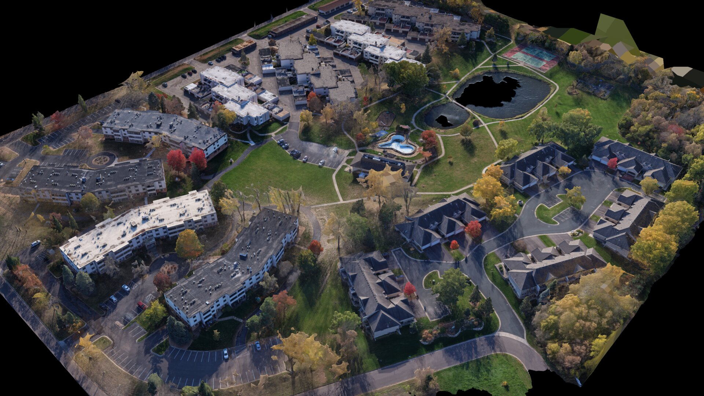

---

## How it was flown

This was a first, extensive test of flying on waypoints. Every mission was planned in QGIS
with FlyPath: a crosshatched grid, one large orbit around the whole site and ten smaller orbits
spread across it, flown back to back on four batteries in 90 minutes.

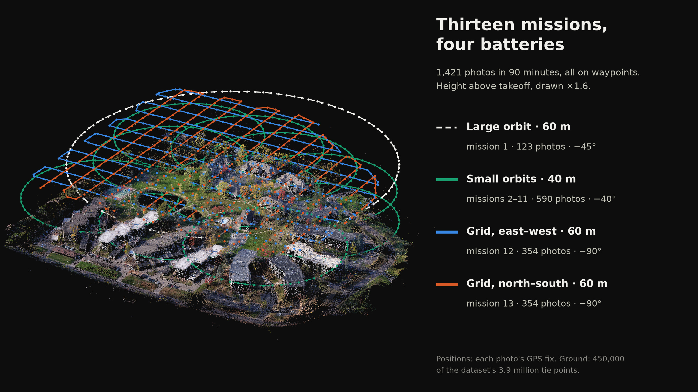

**The grids** — the same area flown twice at 60 m, the second pass turned 90° to the first,
camera straight down. 708 photos, a photo every 12.7 m along lines 27 m apart.

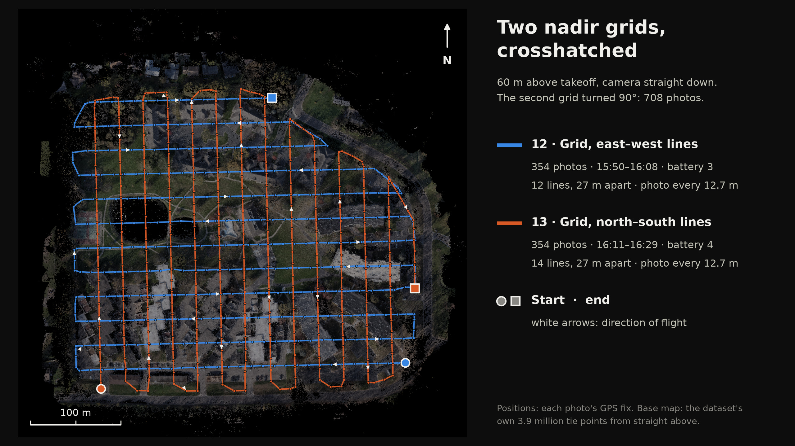

**The orbits** — one large circle of 200 m radius at 60 m, then ten circles of 95 m radius at
40 m, each with the camera tilted toward its center, so every building is seen from all sides.
All eleven fly clockwise.

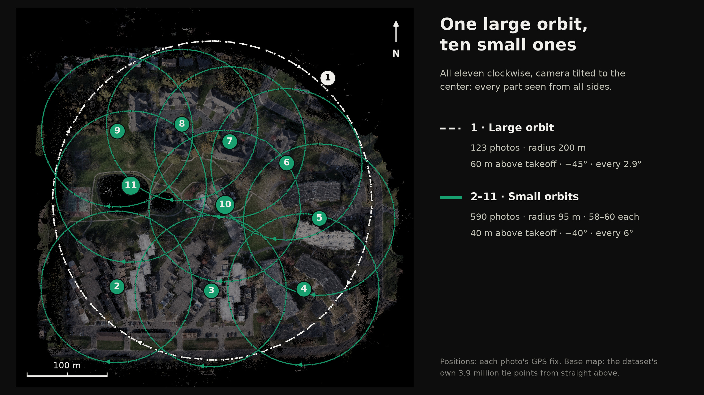

| mission | battery | type | time | photos | height above takeoff | camera |
|---|---|---|---|---|---|---|
| 1 | 1 | large orbit, radius 200 m, a photo every 2.9° | 14:59–15:06 | 123 | 60 m | −45° |
| 2 | 1 | orbit, radius 95 m, a photo every 6° | 15:07–15:10 | 58 | 40 m | −40° |
| 3 | 1 | orbit | 15:11–15:14 | 60 | 40 m | −40° |
| 4 | 1 | orbit | 15:15–15:18 | 59 | 40 m | −40° |
| 5 | 1 | orbit | 15:19–15:21 | 59 | 40 m | −40° |
| 6 | 1 | orbit | 15:22–15:25 | 60 | 40 m | −40° |
| 7 | 1 | orbit | 15:26–15:29 | 60 | 40 m | −40° |
| 8 | 2 | orbit | 15:32–15:35 | 58 | 40 m | −40° |
| 9 | 2 | orbit | 15:36–15:39 | 58 | 40 m | −40° |
| 10 | 2 | orbit | 15:40–15:42 | 59 | 40 m | −40° |
| 11 | 2 | orbit | 15:43–15:46 | 59 | 40 m | −40° |
| 12 | 3 | nadir grid, 12 east–west lines | 15:50–16:08 | 354 | 60 m | −90° |
| 13 | 4 | nadir grid, 14 north–south lines | 16:11–16:29 | 354 | 60 m | −90° |

Photos are 3 seconds apart on every mission, apart from a few longer gaps at the grid turns
and two 11–12-second gaps midway round the large orbit. Each photo's mission and battery are in the
`mission`, `mission_type` and `battery` columns of
[`images.csv`](https://github.com/Matt1Up/plymouth-mn-residential-survey-photogrammetry-dataset/blob/main/manifest/survey/images.csv),
and each mission's geometry is in
[`missions.csv`](https://github.com/Matt1Up/plymouth-mn-residential-survey-photogrammetry-dataset/blob/main/manifest/survey/missions.csv).
That makes it easy to train or solve on one part of the capture: only the nadir grids, only the
orbits, or one orbit at a time.

## The site

Apartment buildings, townhomes, two ponds, a pool and tennis courts on a residential campus in
Plymouth, Minnesota, in full fall color.

| | |
|---|---|
| reconstructed area | **15.0 ha**, about 465 × 455 m |
| ground to rooftops and treetops | 2 m to 22 m above the takeoff point |
| height above the ground | about **54 m** under the grids, **34 m** under the small orbits |
| camera positions span | 443 × 409 m |

The takeoff point sat about 5 m below most of the site, so the drone flew lower above the
ground than its 60 m and 40 m above takeoff. These figures are measured from the tie points in
the GPS-fitted frame described [below](#coordinate-frame): good to a few meters, not a survey.
The area counts 5 m cells holding at least 20 tie points.

## Gallery

Renders of the textured model reconstructed from these photographs. The model itself is not
part of the dataset.

| | |
|---|---|
| 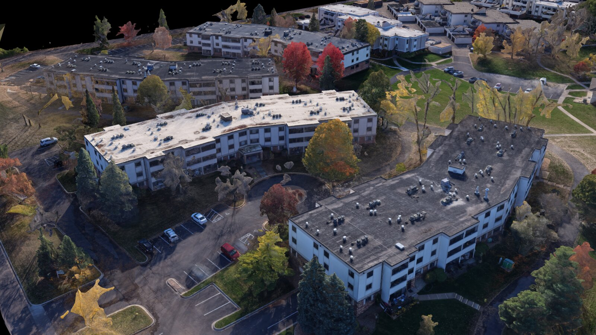 | 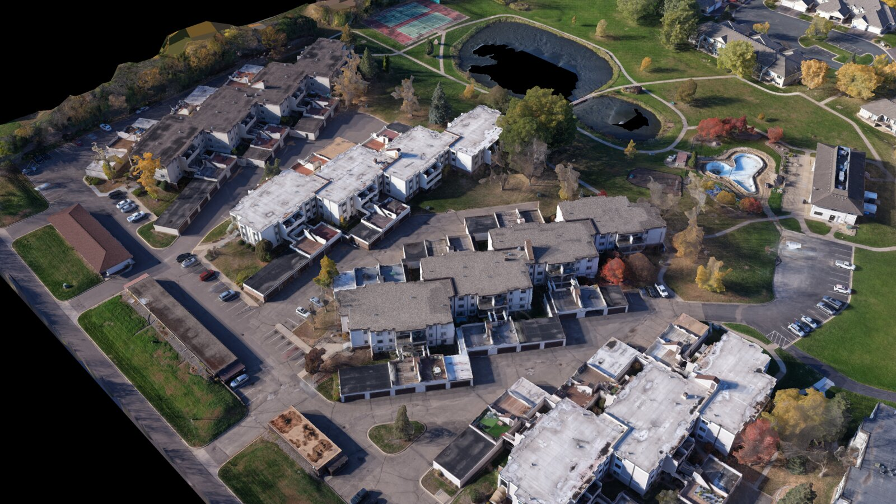 |
| 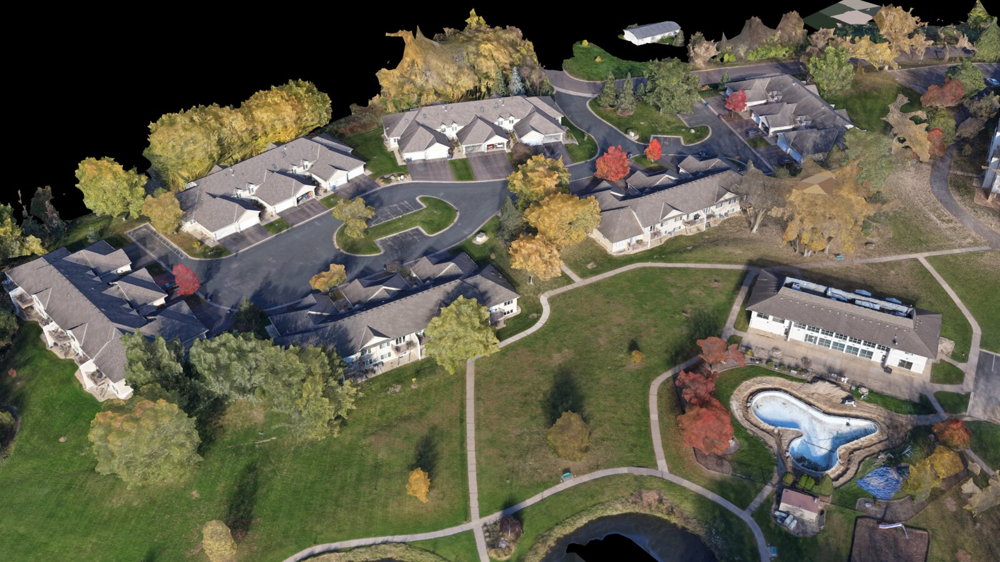 | 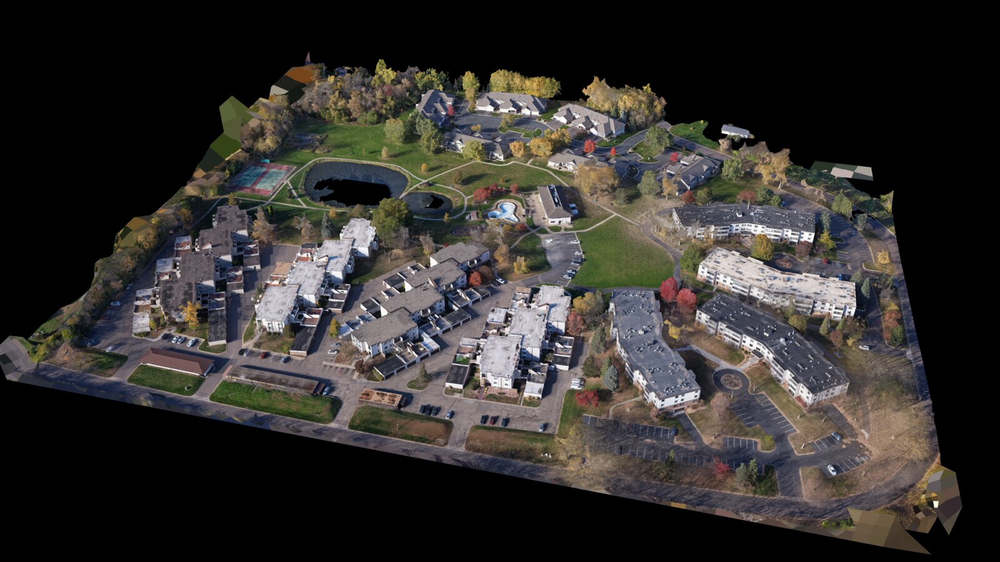 |
| 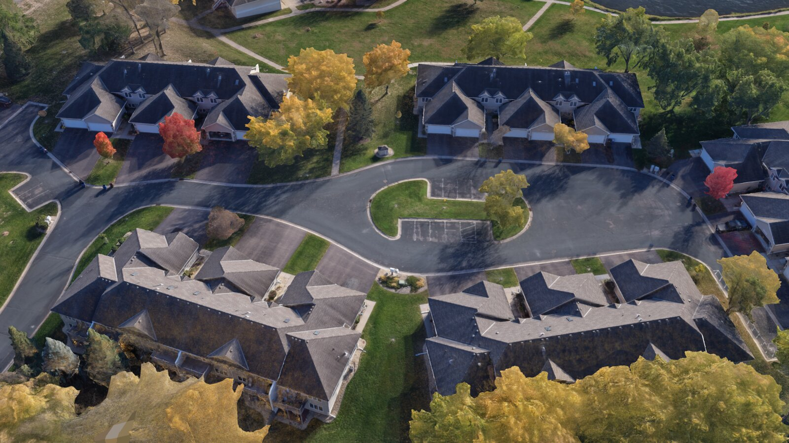 | 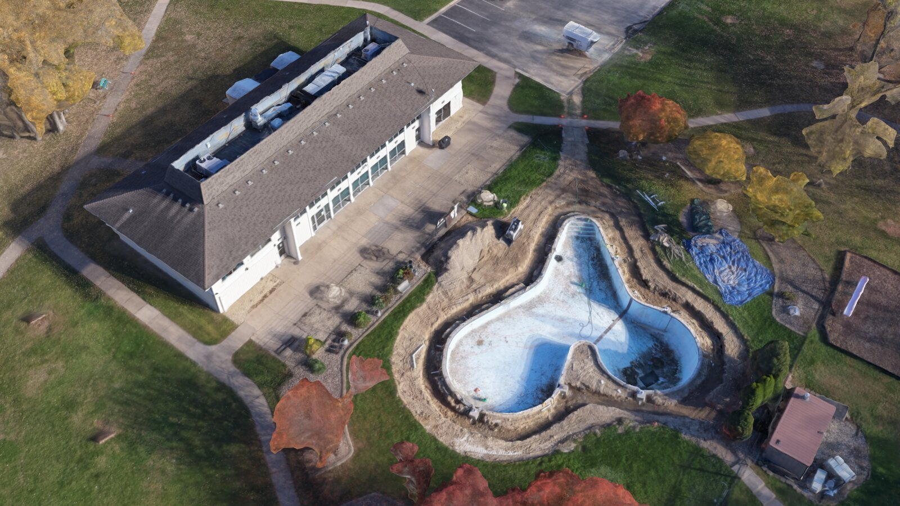 |
| 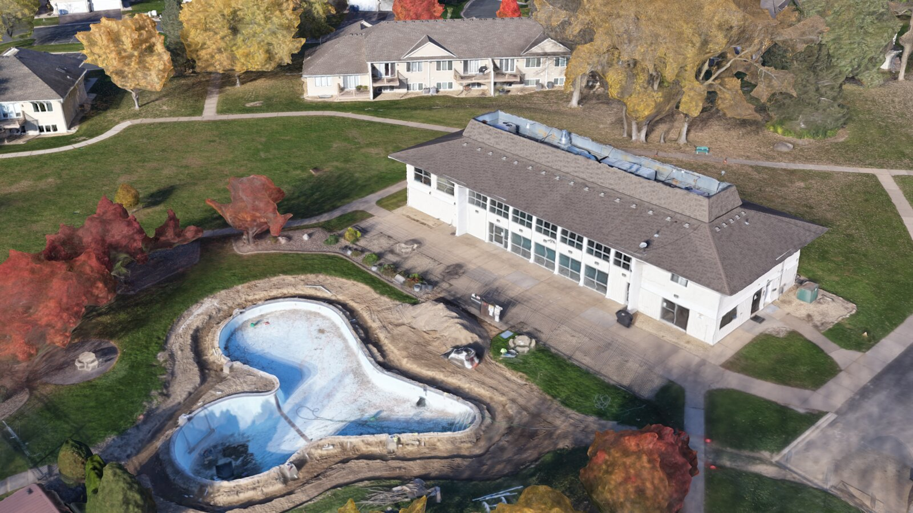 | 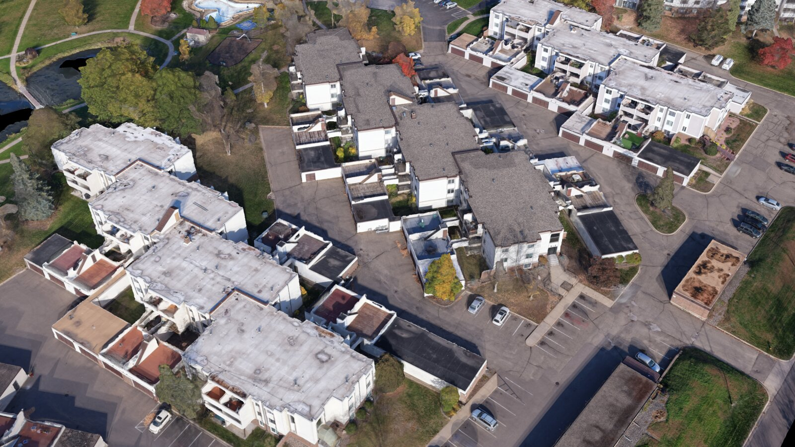 |
| 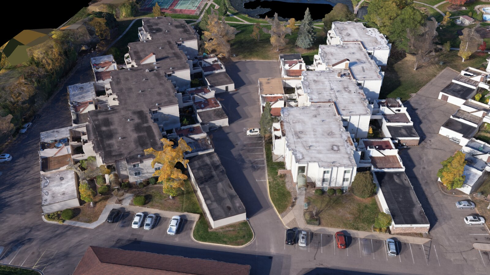 | 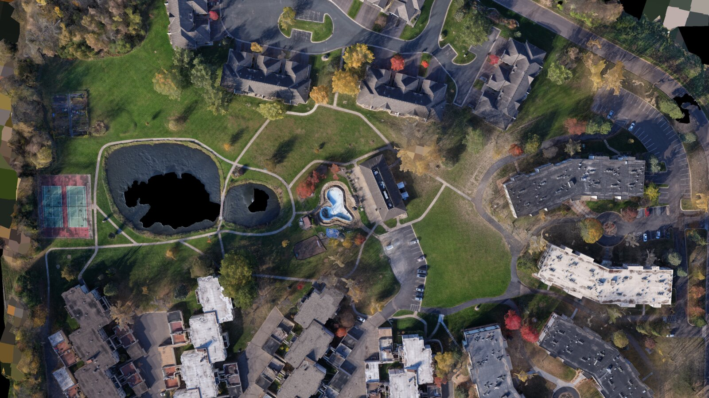 |

## What's in it

| | |
|---|---|
| images | 1,421 |
| size | 16.23 GB |
| missions | 13 — 2 nadir grids, 1 large orbit, 10 small orbits |
| aligned | **1,414 / 1,421**, one component |
| camera poses | 1,414, COLMAP and RealityScan XMP, for the original photos ([below](#camera-poses)) |
| tie points | 3,893,468 |
| coordinate frame | meters, fitted to GPS — no physical scale reference |

## Capture

| | |
|---|---|
| **Camera** | DJI FC9313, 8.7 mm, f/1.8 |
| **Resolution** | 4096 × 3072 — native sensor readout, not an interpolated mode |
| **ISO** | 100 throughout |
| **Shutter** | 1/3200 s to 1/800 s |
| **Geotagging** | GPS on every frame — 1,421 / 1,421 |
| **Filenames** | original as written by the aircraft |
| **Files** | all 1,421 are camera originals, byte for byte |
| **Flown** | October 22, 2026, 14:59–16:29 local time, four batteries |
| **Height** | 40 m and 60 m above the takeoff point |
| **Gimbal** | −90° (straight down) for the grids, −40° to −45° for the orbits |

Native resolution matters. These drones offer a higher-megapixel mode that interpolates from
the same sensor well — it invents texture, and a photogrammetry solver treats invented texture
as real observations. Everything here is the native readout.

## Coordinate frame

**There is no physical scale reference in this capture.** RealityScan solved the photos in its
own arbitrary units, and the whole solve was then fitted to the photos' own GPS positions with
one similarity transform — scale, rotation and shift. Nothing inside the solve changed.

| | |
|---|---|
| axes | x east, y north, z up, in meters |
| origin | latitude 45.035200, longitude −93.415800; z = 0 at the takeoff point |
| fit, solved camera vs its GPS position | 3.6 m median (2.2 m horizontal, 2.5 m vertical), 11.1 m at worst |

So sizes and distances in the poses are right to within what consumer GPS allows over a 450 m
site: fine for orientation and approximate measures, not for survey work. The transform and
its residuals are in
[`poses/survey/frame.txt`](https://github.com/Matt1Up/plymouth-mn-residential-survey-photogrammetry-dataset/blob/main/poses/survey/frame.txt),
so RealityScan's original frame can be recovered exactly.

## Camera poses

Solved in RealityScan 2.2, exported for **the original photos**: the files in `survey/images/`,
as they are. No undistortion is needed to use them.

- **One camera per photo.** RealityScan solved the focal length, principal point and lens
  distortion of each photo separately, so `cameras.txt` holds one camera for every image.
  Forcing one shared camera onto all of them fits these poses clearly worse.
- **OpenCV distortion.** COLMAP's `FULL_OPENCV` model: radial k1, k2, k3 and tangential p1, p2,
  with k4–k6 zero. The coefficients describe the original 4096 × 3072 photos.
- **In meters**, in the [GPS-fitted frame](#coordinate-frame) above.
- **1,414 poses**, every aligned photo. Solved focal lengths run 21.2–27.7 mm (35 mm
  equivalent, median 24.0), so none is left out.

| file | GitHub | Hugging Face | size |
|---|---|---|---|
| `cameras.txt`, `images.txt` | [`poses/survey/colmap/`](https://github.com/Matt1Up/plymouth-mn-residential-survey-photogrammetry-dataset/tree/main/poses/survey/colmap) | `survey/poses/colmap/` | 0.4 MB |
| `points3D.txt` — the 3,893,468 tie points, position and color | too big for GitHub | [`survey/poses/colmap/points3D.txt`](https://huggingface.co/datasets/Matt1up/plymouth-mn-residential-survey-photogrammetry/resolve/main/survey/poses/colmap/points3D.txt) | 0.17 GB |
| RealityScan XMP, one per photo, named after it | [`poses/survey/xmp/`](https://github.com/Matt1Up/plymouth-mn-residential-survey-photogrammetry-dataset/tree/main/poses/survey/xmp) | `survey/poses/xmp/` | 1.7 MB |

Checksums for all of them are in
[`manifest/survey/poses.sha256`](https://github.com/Matt1Up/plymouth-mn-residential-survey-photogrammetry-dataset/blob/main/manifest/survey/poses.sha256).
RealityScan does not export which photos saw each tie point, so `points3D.txt` has no tracks and
the point lines in `images.txt` are empty.

Checked on the original photos: SIFT matches between neighboring frames sit 0.2–0.5 px (median)
from the epipolar lines the published poses imply, on the large orbit, the small orbits and both
grids.

## Gaussian splatting

Poses and tie points are what 3DGS and NeRF pipelines ingest, so the scan trains without
running structure-from-motion first. Tools that accept only pinhole cameras, such as the
reference 3DGS code, need undistorted copies first; COLMAP's `image_undistorter` makes them
from these files. Downsample to ~1600 px before training.

The mix of views is the point of the set: straight-down grids for the roofs and the ground,
oblique orbits for the walls. Train on everything, or use the `mission` column to see what each
part of the capture adds.

## Reproducing

The images are ordinary geotagged JPEGs, so any structure-from-motion tool reads them. See
[docs/reproduce.md](https://github.com/Matt1Up/plymouth-mn-residential-survey-photogrammetry-dataset/blob/main/docs/reproduce.md)
for what to expect.

## Download details

**→ [huggingface.co/datasets/Matt1up/plymouth-mn-residential-survey-photogrammetry](https://huggingface.co/datasets/Matt1up/plymouth-mn-residential-survey-photogrammetry)**

**Everything in one file** — the ZIP, 16.23 GB (16,229,373,816 bytes). Stored, not
compressed: the JPEGs inside are the original files, byte for byte, in one folder.

```bash
curl -LO https://huggingface.co/datasets/Matt1up/plymouth-mn-residential-survey-photogrammetry/resolve/main/zip/plymouth-mn-residential-survey-images.zip
sha256sum plymouth-mn-residential-survey-images.zip
# 20143d2f80d3444a5b1e2758b7d2110721651d2a32bb996bc7197c3715458c40
unzip plymouth-mn-residential-survey-images.zip
```

If the download stops, `curl -C - -LO <same URL>` carries on from where it stopped.

**One file at a time, one command.** Run it again if it stops — finished files are skipped.

```bash
pip install -U huggingface_hub
hf download Matt1up/plymouth-mn-residential-survey-photogrammetry --repo-type dataset --local-dir ./survey --include 'survey/images/*'
```

Leave out `--include` to take everything: images, ZIP and poses (32.64 GB — the images twice).

**Or the helper scripts** from the [GitHub repo](https://github.com/Matt1Up/plymouth-mn-residential-survey-photogrammetry-dataset),
which wrap the same command and add `verify.sh` to check every file against the published
SHA-256 lists:

```bash
git clone https://github.com/Matt1Up/plymouth-mn-residential-survey-photogrammetry-dataset && cd plymouth-mn-residential-survey-photogrammetry-dataset

./scripts/download.sh --images   # 16.23 GB, file by file
./scripts/download.sh --zip      # 16.23 GB, one file
./scripts/download.sh --poses    # poses and tie points (0.17 GB)
./scripts/verify.sh
```

More detail in **[docs/download.md](https://github.com/Matt1Up/plymouth-mn-residential-survey-photogrammetry-dataset/blob/main/docs/download.md)**.

## Notes

- The orbits look out past the site to neighboring buildings, streets and parked cars.
- 7 of 1,421 images do not align ([`unaligned.txt`](https://github.com/Matt1Up/plymouth-mn-residential-survey-photogrammetry-dataset/blob/main/poses/survey/unaligned.txt)):
  six straight-down frames over dense tree canopy and one orbit frame with a tree close in front
  of the camera. Their photos still ship.
- The mission maps are drawn from each photo's own GPS position over the dataset's own tie
  points — no satellite or map imagery
  ([`scripts/make-mission-maps.py`](https://github.com/Matt1Up/plymouth-mn-residential-survey-photogrammetry-dataset/blob/main/scripts/make-mission-maps.py)).

## License

[](https://creativecommons.org/licenses/by/4.0/)

[Creative Commons Attribution 4.0](LICENSE). Commercial use and ML training are fine. Credit required.

```
Thirteen Mission Waypoint Drone Survey | Plymouth, Minnesota, USA — Matthew Guertin, 2026. CC BY 4.0.
https://github.com/Matt1Up/plymouth-mn-residential-survey-photogrammetry-dataset
```

## Related

- **[Abandoned Graffiti Mill](https://github.com/Matt1Up/abandoned-graffiti-mill-photogrammetry-dataset)** — the Früen Mill in Minneapolis, inside and out, metrically scaled.
- **[Drone building scans](https://github.com/Matt1Up/drone-building-scans-dataset)** — two commercial buildings, with poses.
- **[Tree photogrammetry dataset](https://github.com/Matt1Up/tree-photogrammetry-dataset)** — 812 images of one tree, with COLMAP poses.
- **[Chicago / Grant Park](https://github.com/Matt1Up/chicago-photogrammetry-dataset)** — 2,751 aerial images and 241 laser scan files over downtown Chicago.
- **[mattguertin.com](https://mattguertin.com)**
